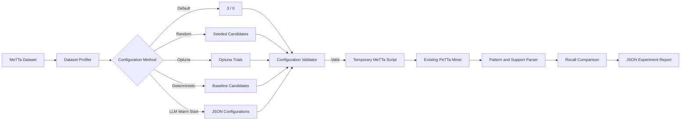

# Hyperon Miner Configuration Optimizer

<div align="center">


**An empirical LLM-assisted prototype for finding faster Hyperon/PeTTa miner configurations while preserving symbolic mining behavior.**

</div>

---

## Assignment Overview

This project investigates the question:

> **How can an LLM be integrated with Hyperon Miner to improve usability, correctness, or performance while preserving verifiable symbolic behavior?**

The prototype addresses **performance**: it proposes miner configurations, executes them through the existing PeTTa miner, validates symbolic results, and measures runtime and memory. The LLM is a configuration planner only—it never generates patterns or rewrites the miner.

### Research Goal

Find whether LLM warm start can find a low-runtime, valid miner configuration within a small fixed trial budget while maintaining measured recall against a reference run.

---

## What This Prototype Does

- Profiles an input `.metta` dataset.
- Validates the nine-argument miner configuration.
- Executes the existing Hyperon/PeTTa implementation unchanged.
- Measures elapsed runtime and process memory delta.
- Parses support values and symbolic pattern identities.
- Compares candidate pattern sets against a reference pattern set.
- Reports default, random, Optuna, deterministic, and LLM warm-start methods.
- Uses a live LLM proposal path for warm-start experiments; deterministic search is a separate reproducible baseline.

The prototype does **not** replace symbolic mining with an LLM. PeTTa remains the source of all pattern results.

---

## Architecture



### LLM Boundary

The proposal service receives dataset summary statistics and previous run metadata only.

It must return JSON parameter sets such as:

```json
{
  "configurations": [
    {
      "min_support": 3,
      "depth": 0,
      "mode": "none",
      "normalization": "none",
      "db_ratio": "none",
      "conj_exp": true,
      "init_pattern": "$x"
    }
  ]
}
```

The LLM never receives or invents pattern identities, support values, or mining results.

### Failure Handling

- Missing credentials in a live experiment: fail before recording LLM evidence.
- Transient provider errors: retry a bounded number of times, then fail the live experiment.
- Offline fallback: available only with the explicit `--allow-llm-fallback` option and excluded from live evidence.
- Invalid configuration: recorded as `invalid`.
- PeTTa timeout: recorded as `timeout`.
- Miner crash or nonzero exit: recorded as `failed`.

---

## Experiment Protocol

The live experiment recorded in [live-llm-experiment.json](./live-llm-experiment.json) used:

| Setting | Value |
|---|---|
| Trial budget | 1 trial per method per seed |
| Seeds | `11`, `22`, `33` |
| Timeout | 20 seconds |
| Recall threshold | 20% |
| Dataset | `very-small-ugly.metta` (9 parsed atom lines) |
| Reference config | `min_support=1`, `depth=0` |

The baseline methods are:

- Default configuration
- Seeded random search
- Optuna
- Deterministic heuristic
- LLM warm start

> **LLM status:** The three warm-start rows were live Gemini calls using `gemini-3.1-flash-lite`. Each response reported `real_llm=true` and zero LLM fallbacks. All three PeTTa trials completed in 8.234–9.487 seconds but produced no qualifying recall against the depth-0 reference.

---

## Measured Results

### Smoke Test

A one-config smoke test completed successfully in **4.486 seconds** and parsed **2 patterns**.

The raw symbolic output contained:

```text
(supportOf (, (Inheritance $_0 $_1) (Inheritance $_0 $_2)) 21)
(supportOf (, (Inheritance $_0 $_1) (Inheritance $_2 $_1)) 27)
```

### Live LLM Run

| Method | Seed | Provider | Miner status | Miner runtime | Recall |
|---|---:|---|---|---:|---:|
| Deterministic baseline | 11 | baseline | ok | 3.622 s | 100% |
| Deterministic baseline | 22 | baseline | ok | 3.803 s | 100% |
| Deterministic baseline | 33 | baseline | ok | 4.498 s | 100% |
| LLM warm start | 11 | Gemini | ok | 9.487 s | 0% |
| LLM warm start | 22 | Gemini | ok | 8.591 s | 0% |
| LLM warm start | 33 | Gemini | ok | 8.234 s | 0% |

### Comparison Verdict

**Verdict: inconclusive**

- The provider calls were real Gemini responses with no LLM fallback.
- The LLM-selected depth-1 configuration did not meet the 20% recall threshold in any of the three completed miner runs.
- The deterministic baseline recovered all 18 reference patterns in each seed and ran faster than every LLM-selected run.
- This one-dataset, one-trial-per-seed run does not establish a performance benefit for the LLM.

Full evidence is available in [`results/`](../results/):

- [Problem sweep](../results/problem_sweep.md)
- [Testable hypothesis](../results/hypothesis.md)
- [Baseline comparison](../results/comparison.md)
- [Architecture](../results/architecture.md)
- [Presentation slides](../results/slides.md)

---

## Running the Prototype

### Prerequisites

- Python 3.11
- PeTTa
- SWI-Prolog available on `PATH`
- Optuna for Optuna experiments

On macOS, expose the installed SWI-Prolog executable before running experiments:

```bash
export PATH="/Applications/SWI-Prolog.app/Contents/MacOS:$PATH"
```

Verify the environment:

```bash
swipl --version
python3 --version
```

### Manual Configuration Run

```bash
cd hyperon-miner

.venv/bin/python optimizer/prototype.py \
  --repo . \
  --dataset experiments/data/very-small-ugly.metta \
  --petta /path/to/PeTTa/run.sh \
  --petta-venv .venv \
  --trials 3 \
  --timeout 30 \
  --output optimizer-report.json
```

### Manual Configuration File

```bash
.venv/bin/python optimizer/prototype.py \
  --repo . \
  --dataset experiments/data/very-small-ugly.metta \
  --petta /path/to/PeTTa/run.sh \
  --petta-venv .venv \
  --config-file optimizer/manual-baseline.json \
  --trials 2 \
  --timeout 30 \
  --output optimizer/manual-report.json
```

### Experiment Mode

```bash
.venv/bin/python optimizer/prototype.py experiment \
  --repo . \
  --dataset experiments/data/very-small-ugly.metta \
  --petta /path/to/PeTTa/run.sh \
  --petta-venv .venv \
  --trials 1 \
  --timeout 30 \
  --seeds 11 22 33 \
  --methods default random optuna deterministic llm-warmstart \
  --recall-threshold 0.20 \
  --llm-mode warmstart \
  --output experiment-report.json
```

### Real OpenAI-Compatible Provider

Set a provider key and optional endpoint/model:

```bash
export OPENAI_API_KEY="your-api-key"
export LLM_PROVIDER="openai"
export OPENAI_MODEL="gpt-4o-mini"
# Optional:
export OPENAI_BASE_URL="https://api.openai.com/v1/chat/completions"
```

Run the experiment without fallback enabled. Provider usage and errors are recorded in the experiment report; a provider failure stops a live experiment.

### Gemini Provider

Gemini is the default provider and uses the native `generateContent` API. For a
consistent project-wide setup, copy the repository's `.env.example` to `.env` and
replace the placeholder key. Both CLI modes load that file, and explicit shell
variables take precedence. You can also export the variables directly:

```bash
export GEMINI_API_KEY="your-gemini-api-key"
export GEMINI_MODEL="gemini-3.1-flash-lite"
unset GEMINI_BASE_URL
```

Run with the default strict live mode. Verify each warm-start report row says
`"provider": "gemini"` and `"real_llm": true` before counting it as live LLM
evidence. Missing credentials, provider errors, and invalid responses fail the
run instead of being recorded as LLM results. Use
`--allow-llm-fallback` only for explicitly offline development runs.

---

## Miner Configuration

The existing implementation accepts:

```text
(pattern-miner output-space input-space init-pattern
               min-support depth mode normalization
               db-ratio conj-exp)
```

The default experiment configuration is:

```text
min_support=3
depth=0
mode=none
normalization=none
db_ratio=none
conj_exp=true
init_pattern=$x
```

---

## Testing

Run the optimizer test suite from `hyperon-miner/`:

```bash
.venv/bin/python -m unittest discover -s optimizer -p 'test_*.py' -v
```

The suite covers configuration validation, output parsing, pattern-set parsing, script generation, live-mode credential enforcement, offline fallback behavior, test-double PeTTa execution, timeout serialization, and CLI report creation.

---

## Limitations

- Runtime and memory are process-level measurements, not isolated algorithm-only profiles.
- Memory values are child-process high-water-mark deltas.
- Recall is set-based; it does not model pattern support ranking.
- Live LLM quality is only demonstrated by reports whose provider metadata says `real_llm=true`; offline fallback runs are not evidence.
- Random, Optuna, and warm-start methods currently use a small one-trial budget.
- The prototype does not modify or replace the PeTTa symbolic miner.
- PeTTa startup and interpreter behavior are included in measured runtimes.

---

## Repository Structure

```text
optimizer/
├── prototype.py        Backward-compatible CLI entry point
├── cli.py              Normal and experiment CLI workflows
├── miner.py            Dataset analysis, script generation, and PeTTa runs
├── llm.py              LLM configuration proposals and explicit offline fallback
├── search.py           Candidate generation and result selection
├── models.py           Shared configuration and result data models
├── env.py              Project .env loading
├── test_prototype.py   Unit and CLI tests
├── README.md           Assignment and usage documentation
└── *.json              Configuration and report examples

results/
├── problem_sweep.md
├── hypothesis.md
├── comparison.md
├── architecture.md
└── slides.md
```
