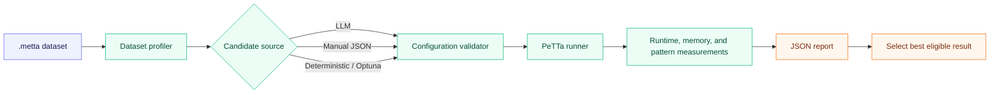

# Pattern Miner Configuration Optimizer

<p align="center">
  <a href="https://www.python.org/"></a>
  <a href="https://github.com/trueagi-io/PeTTa"></a>
  <a href="https://www.swi-prolog.org/"></a>
  <a href="https://optuna.org/"></a>
  
</p>

> A measured search layer for finding better-coverage and valid configurations
> for the Hyperon/PeTTa Pattern Miner.

The optimizer profiles a dataset, generates candidate configurations, executes
each candidate through PeTTa, and writes a machine-readable report containing
the measured results.

The optimizer is an experiment runner, not a replacement for the symbolic
miner. PeTTa remains responsible for generating patterns; the optimizer only
chooses which valid configuration to run.

## Workflow



## How it works

For each run, the optimizer:

1. Profiles the input `.metta` dataset.
2. Generates candidate configurations using an LLM, a manual file, or a
   deterministic search strategy.
3. Validates each candidate against the dataset profile.
4. Runs the candidate through PeTTa with a timeout.
5. Records elapsed time, peak memory, pattern counts, support values,
   surprisingness values, stdout, stderr, and the final status.
6. Selects the best eligible result: normal mode prioritizes runtime, while
   LLM experiment mode first requires a measurable mining-coverage improvement.

The normal workflow selects a result by runtime. Experiment mode compares
candidate-generation methods and can apply a recall threshold against a
reference run.

## Requirements

- Python 3.11 or newer (the live rerun used Python 3.15.2)
- PeTTa and SWI-Prolog available in the execution environment
- A PeTTa executable or `run.sh` script
- The Python dependencies in [`requirements.txt`](../requirements.txt)
- Optional: `optuna` for Optuna-based experiments
- Optional: an LLM API key for live configuration proposals

The optimizer is normally run from the `hyperon-miner` directory:

```bash
cd hyperon-miner
python3.11 -m venv .venv
.venv/bin/python -m pip install -r requirements.txt
```

Install Optuna only when using the `optuna` experiment method:

```bash
.venv/bin/python -m pip install optuna
```

For PeTTa installation and SWI-Prolog setup, see the [official PeTTa setup
guide](https://github.com/trueagi-io/PeTTa/tree/main).

## Quick start

Run the optimizer against a dataset and provide the path to the PeTTa
executable:

```bash
.venv/bin/python optimizer/prototype.py \
  --repo . \
  --dataset experiments/data/very-small-ugly.metta \
  --petta /path/to/PeTTa/run.sh \
  --petta-venv .venv \
  --trials 3 \
  --timeout 30 \
  --allow-llm-fallback \
  --output optimizer-report.json
```

The `--petta` option defaults to the `PETTA` environment variable, or to
`petta` when `PETTA` is not set. Shell scripts are invoked with `sh`.

The example enables deterministic fallback so it can run without an LLM API
key. Remove `--allow-llm-fallback` when live LLM proposals are configured.

The command exits with status `0` when an eligible result is selected and
status `2` when no candidate satisfies the selection criteria.

### Run with a manual configuration file

Use `--config-file` to skip LLM proposals and run configurations from a JSON
array. At most `--trials` entries are executed:

```bash
.venv/bin/python optimizer/prototype.py \
  --repo . \
  --dataset experiments/data/very-small-ugly.metta \
  --petta /path/to/PeTTa/run.sh \
  --config-file optimizer/manual-baseline.json \
  --output manual-report.json
```

### Compare search methods

Experiment mode compares multiple candidate-generation methods across one or
more seeds:

```bash
.venv/bin/python optimizer/prototype.py experiment \
  --repo . \
  --dataset experiments/data/very-small-ugly.metta \
  --petta /path/to/PeTTa/run.sh \
  --trials 3 \
  --seeds 11 22 33 \
  --methods default random optuna deterministic llm-warmstart \
  --recall-threshold 1.0 \
  --output experiment-report.json
```

Experiment mode first creates a reference result using
`min_support=1`, `depth=0`, and conjunction expansion disabled. A candidate is
eligible for recall-based comparison only when its pattern recall meets
`--recall-threshold`.

For `llm-warmstart`, promotion requires a successful live proposal to preserve
the reference recall and return more patterns than the project-default
configuration (`min_support=3`, `depth=0`, conjunction expansion enabled).
Runtime is recorded as a secondary metric, while `improved_baseline` indicates
the coverage enhancement.

## LLM configuration proposals

Live LLM proposals are required by default when the normal command does not
use `--config-file`, or when experiment mode includes `llm-warmstart`. To run
without credentials, explicitly enable the deterministic fallback:

```bash
.venv/bin/python optimizer/prototype.py \
  --dataset experiments/data/very-small-ugly.metta \
  --petta /path/to/PeTTa/run.sh \
  --trials 3 \
  --allow-llm-fallback
```

Supported providers and environment variables are:

| Provider | Credential variable | Optional variables |
| --- | --- | --- |
| Gemini (default) | `GEMINI_API_KEY` | `GEMINI_MODEL`, `GEMINI_BASE_URL` |
| OpenAI-compatible | `OPENAI_API_KEY` | `OPENAI_MODEL`, `OPENAI_BASE_URL` |
| Automatic selection | `GEMINI_API_KEY` or `OPENAI_API_KEY` | `LLM_PROVIDER=auto`; prefers Gemini |

Select a provider with `LLM_PROVIDER=gemini`, `LLM_PROVIDER=openai`, or
`LLM_PROVIDER=auto`. The default models are `gemini-3.1-flash-lite` for Gemini
and `gpt-4o-mini` for OpenAI-compatible providers. `LLM_RETRIES` controls the
number of retries for retryable provider responses and defaults to `2`.

The optimizer sends dataset profile information and run metadata to the
selected provider for proposal generation. It does not send the dataset
contents, parsed pattern identities, or raw PeTTa output. LLM-driven runs
evaluate both the `min_support=1`, `depth=0`, `conj_exp=false` reference set and
the project-default `min_support=3`, `depth=0`, `conj_exp=true` baseline. The
reference is the recall guardrail; the default is the coverage-comparison
baseline. Store API keys in the shell environment or in a local `.env` file;
do not commit them.

## Live Gemini + PeTTa evidence

The submission evidence is summarized in
[`results/comparison.md`](./results/comparison.md) and captured in
[`results/gemini-petta-rerun.json`](./results/gemini-petta-rerun.json). The
fresh live call used Gemini `gemini-3.1-flash-lite` with zero fallback. Its
selected proposal produced 18 patterns versus 2 from the default baseline and
recovered 100% of the reference pattern set. The median runtime was 13.09
seconds for the proposal versus 12.04 seconds for the baseline, so the result
is a coverage enhancement with a documented runtime trade-off.

## Submission checklist

- [x] Live Gemini response recorded with `real_llm=true` and zero fallback.
- [x] Every reported live configuration executed by PeTTa.
- [x] Coverage gate and comparison artifacts updated.
- [x] JSON artifacts parse successfully and editor diagnostics report no Python errors.
- [x] Re-ran the 20-test suite after repairing the local Python 3.11 virtual environment: 20 passed.
- [x] Omitted generated `__pycache__/`, `live-run/`, stale root-level smoke or
  experiment reports, and the superseded historical live JSON.

## Miner configuration

Candidates are passed to PeTTa using this call shape:

```text
(pattern-miner output-space input-space init-pattern min-support depth
               mode normalization db-ratio conj-exp)
```

Example JSON configuration:

```json
{
  "min_support": 3,
  "depth": 0,
  "mode": "none",
  "normalization": "none",
  "db_ratio": "none",
  "conj_exp": true,
  "init_pattern": "$x"
}
```

The validator currently enforces the following rules:

- `min_support` must be at least `1` and no greater than the dataset’s atom
  count.
- `depth` must be non-negative.
- `mode` must be `none`, `isurp`, `isurp-old`, or `jsd`.
- When `mode` is `none`, `normalization` and `db_ratio` must both be `none`.
- When `mode` is not `none`, `normalization` must be `True`, `False`, or
  `none`, and `db_ratio` must be `none` or a number in `(0, 1]`.
- A depth greater than zero requires `conj_exp=true`.

## Command-line reference

### Normal mode

| Option | Default | Description |
| --- | --- | --- |
| `--repo` | parent project directory | Repository root used to run PeTTa |
| `--dataset` | required | Input `.metta` dataset |
| `--petta` | `PETTA` or `petta` | PeTTa executable or shell script |
| `--petta-venv` | none | Python 3.11 environment used by SWI-Prolog Janus |
| `--trials` | `4` | Maximum number of candidate configurations |
| `--timeout` | `300` | Per-candidate timeout in seconds |
| `--max-seconds` | none | Maximum eligible runtime |
| `--min-patterns` | `1` | Minimum number of result patterns |
| `--config-file` | none | JSON file containing manual configurations |
| `--allow-llm-fallback` | disabled | Permit deterministic fallback when LLM access fails |
| `--output` | `optimizer-report.json` | JSON report path |

The selected result must have status `ok`, contain at least
`--min-patterns` patterns, and finish within `--max-seconds` when that limit is
provided. Among eligible results, the optimizer chooses the shortest runtime;
surprisingness is used as a tie-breaker.

### Experiment mode

Experiment mode adds the following options:

| Option | Default | Description |
| --- | --- | --- |
| `--seeds` | `11 22 33` | Random/Optuna seeds to evaluate |
| `--methods` | all methods | `default`, `random`, `optuna`, `deterministic`, or `llm-warmstart` |
| `--recall-threshold` | `1.0` | Minimum recall against the reference result |
| `--llm-mode` | `warmstart` | LLM proposal mode; currently only `warmstart` is supported |
| `--allow-llm-fallback` | disabled | Permit deterministic LLM fallback |
| `--output` | `experiment-report.json` | Experiment report path |

If Optuna is not installed, the `optuna` method records a fallback and uses
deterministic candidates. If an LLM request fails and fallback is enabled, the
report records the fallback provider and error metadata.

## Reports

Normal mode writes a JSON object containing:

- the profiled dataset;
- LLM or manual configuration metadata;
- every candidate’s configuration, status, timing, memory, pattern counts,
  support values, surprisingness values, and process output; and
- the selected `best` result and the selection constraints.

Experiment mode additionally records the reference run, seeds, recall
threshold, per-method results, valid-configuration rates, and fallback counts.

Reports are intended for analysis and reproducibility. Paths and provider
metadata may be included in them, so review reports before sharing them outside
the local project.

## Tests

Run the optimizer’s unit and CLI tests from `hyperon-miner`:

```bash
.venv/bin/python -m unittest discover -s optimizer -p 'test_*.py' -v
```

The tests cover configuration validation, dataset profiling, PeTTa result
parsing, provider handling, fallback behavior, and the compatibility entry
point.

## Project layout

| File | Responsibility |
| --- | --- |
| [`prototype.py`](./prototype.py) | Compatibility entry point and public re-exports |
| [`cli.py`](./cli.py) | Normal and experiment command-line workflows |
| [`miner.py`](./miner.py) | Dataset profiling, validation, PeTTa execution, and result parsing |
| [`search.py`](./search.py) | Candidate generation, Optuna integration, recall, and result selection |
| [`llm.py`](./llm.py) | LLM provider integration and deterministic fallback handling |
| [`models.py`](./models.py) | Shared configuration, dataset, and run-result models |
| [`test_prototype.py`](./test_prototype.py) | Unit and CLI regression tests |
| [`results/`](./results/) | Comparison, gate, rerun, and presentation evidence |

## Troubleshooting

### PeTTa cannot be started

Pass the exact path to the executable or script:

```bash
--petta /absolute/path/to/PeTTa/run.sh
```

Confirm that PeTTa can run from the repository root and that SWI-Prolog and
the Python environment used by Janus are available.

### No eligible result is selected

Check the `status` and `error` fields in the report. Common causes are a
timeout, an invalid configuration, zero patterns, or a value of
`--min-patterns` / `--max-seconds` that is too restrictive.

### Live LLM mode fails before execution

Set the matching provider and API key, or use `--config-file` for fully local
execution. `--allow-llm-fallback` is available for offline experiments where
deterministic candidates are acceptable.

### SWI-Prolog reports a Janus/Python warning

Frequent-pattern mining can still complete when SWI-Prolog reports that its
optional Janus bridge cannot load a Python shared library, but the warning
should be fixed before relying on Python interoperability. Use a working
Python 3.11 environment for Janus and pass it with `--petta-venv`.

### The Optuna method falls back

Install the optional dependency in the same environment used to run the
optimizer:

```bash
.venv/bin/python -m pip install optuna
```
