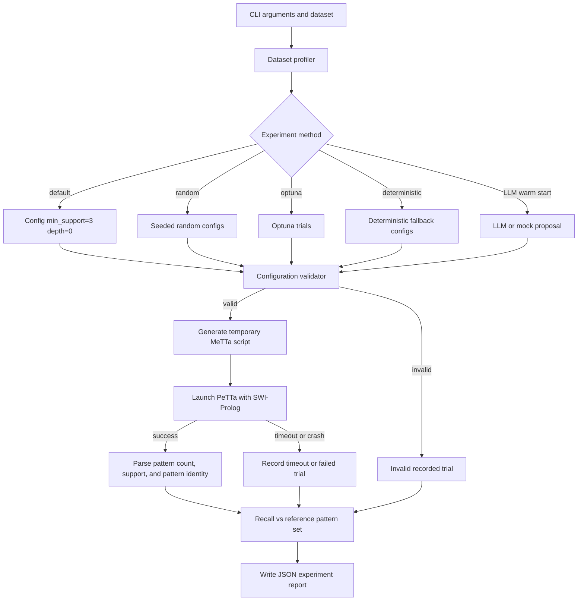

# Existing optimizer architecture

## Components

- Dataset profiler: atom lines, link lines, predicates, symbols, and bytes.
- Configuration validator: support range, depth, supported mode fields, and conjunction-expansion requirements.
- Runner: substitutes parameters into the existing miner script and launches PeTTa.
- Experiment layer: default, seeded random, Optuna, deterministic fallback, and LLM/mock warm start.
- Reporter: records configuration, status, runtime, memory, pattern count, pattern identities, recall, and fallback metadata.

## Data flow

The CLI profiles one dataset and proposes configurations. Each valid configuration produces a temporary MeTTa script. The existing PeTTa runner executes the symbolic miner and stdout is parsed into metrics and pattern identities. The experiment report compares candidate pattern sets with the `min_support=1, depth=0` reference.

## Control flow and failure path

- Missing API key: deterministic fallback.
- Mock mode: deterministic fallback labeled as MOCK.
- LLM error or invalid JSON: existing code records fallback metadata and uses deterministic candidates.
- Invalid configuration: recorded as invalid without launching PeTTa.
- Miner timeout or nonzero process exit: recorded as timeout or failed.
- The LLM receives only dataset summary statistics and prior-run metadata. It is instructed to return JSON parameter sets only and never pattern identities or mined results.
