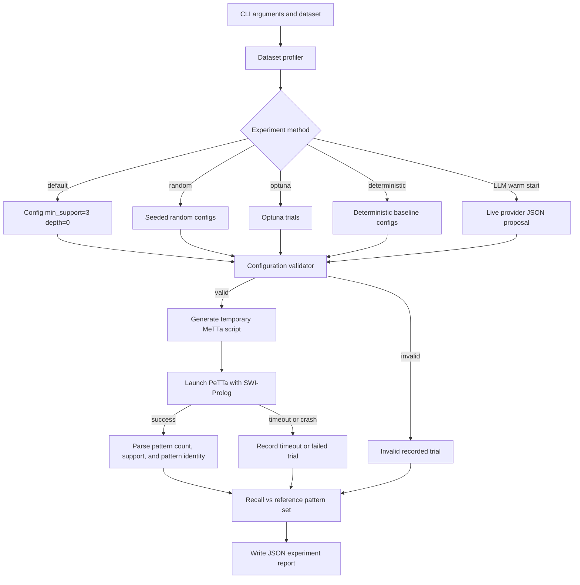

# Existing optimizer architecture

## Components

- Dataset profiler: atom lines, link lines, predicates, symbols, and bytes.
- Configuration validator: support range, depth, supported mode fields, and conjunction-expansion requirements.
- Runner: substitutes parameters into the existing miner script and launches PeTTa.
- Experiment layer: default, seeded random, Optuna, deterministic baseline, and live LLM warm start.
- Reporter: records configuration, status, runtime, memory, pattern count, pattern identities, recall, and provider metadata.

## Data flow

The CLI profiles one dataset and sends only summary statistics and prior-run
metadata to the LLM provider. The provider returns JSON parameter sets; it
never receives or generates pattern identities, support values, or mining
results. Each valid configuration produces a temporary MeTTa script. PeTTa
executes the symbolic miner, and stdout is parsed into metrics and pattern
identities. The experiment report compares candidate pattern sets with the
`min_support=1, depth=0` reference.

## Failure path

- Missing credentials in live mode: fail before recording LLM evidence.
- Transient provider status: bounded retry, then fail the live run.
- Invalid JSON or invalid configuration: fail the live run.
- Explicit `--allow-llm-fallback`: deterministic fallback for offline development only.
- Invalid configuration: recorded as invalid without launching PeTTa.
- Miner timeout or nonzero process exit: recorded as timeout or failed.

## LLM quality gate

Live LLM proposals are evaluated separately from the always-run reference
set and the project-default baseline. A proposal is promoted only when it
completes successfully, preserves at least the default baseline's reference
recall, and returns strictly more patterns. Runtime remains visible as a
secondary metric because mining coverage is the primary objective. The fresh
rerun passes this gate with 18 live-Gemini patterns versus 2 default patterns.
