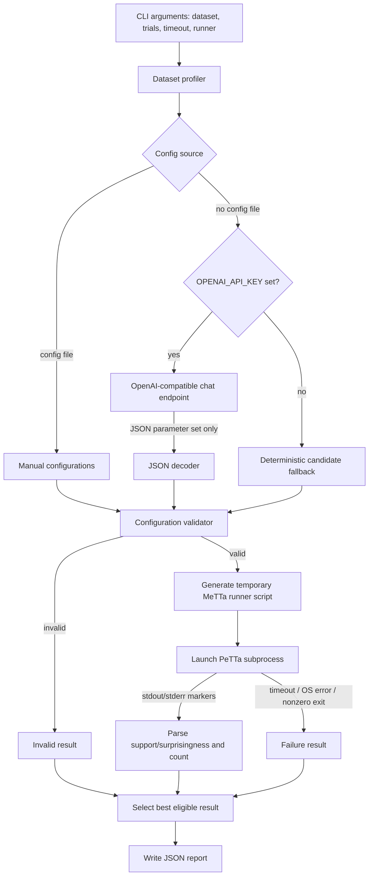

# Existing optimizer architecture

## Components and data flow

- **CLI (`optimizer/prototype.py`)** accepts a dataset, PeTTa executable, optional Python 3.11 venv, trial limit, timeout, optional manual JSON config list, and output path.
- **Profiler** counts parsed atom/link lines, predicates, symbols, and bytes. The profile accompanies LLM proposal input and config validation.
- **Configuration source** is either a JSON file or the proposal function. With `OPENAI_API_KEY`, the HTTP endpoint receives the dataset profile, previous runs, schema, and an instruction to return configurations. Without the key, deterministic candidates are returned.
- **LLM boundary**: the model is asked to return JSON configurations only. Its response is parsed into `Config` parameter sets; patterns remain the miner's output and are not requested from the LLM.
- **Validator** checks support/depth ranges, supported modes, normalization and database-ratio combinations, and the relationship between depth and conjunction expansion.
- **Runner** substitutes dataset and parameter values into a temporary MeTTa script, launches PeTTa, and records elapsed time, child-process memory delta, stdout/stderr, status, and parsed pattern/support metrics.
- **Selector/reporter** filters to successful runs meeting `min_patterns` and optional time limit, selects the fastest eligible result, and writes the JSON report.

## Control flow and failure path

An invalid configuration becomes an `invalid` result without launching PeTTa. A subprocess timeout yields `timeout`; an OS launch error or nonzero runner exit yields `failed`. An HTTP/JSON/proposal exception in the LLM path is caught and converted into deterministic proposals with fallback metadata. The CLI writes a report and exits with status 2 when no eligible best run exists.

In the recorded attempts, control reached the PeTTa shell script, which could not find `swipl`; each miner trial therefore produced a `failed` result before parsing any patterns. The repository's current CLI has no random-search, Optuna, reference-recall, or seed-control component.
